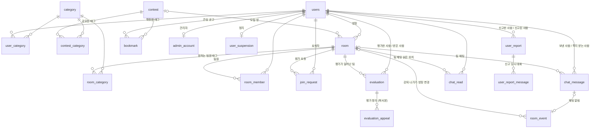

# DB 명세서 (초안)

> 상태: 초안 · 팀 검토 전
> 기준: [기능 명세서 v0.5](feature-spec.md), [시연용 데이터](demo-data.md), [README 기술 스택](../README.md#기술-스택)
> DB: MySQL 8 · InnoDB · `utf8mb4` / `utf8mb4_0900_ai_ci` · JPA `ddl-auto=none`, 테이블은 아래 DDL을 담당별 `db/schema/*.sql` 파일로 만듭니다.

## 1. 한눈에 보기



| 테이블 | 내용 | 만드는 사람 | 읽는 기능 |
|---|---|---|---|
| `category` | 고정 태그 목록 (X-2) | A | 전체 |
| `users` | 사용자 (A-1) | A | 전체 (X-1 헤더), C-5, C-6, D-3, D-4 |
| `user_category` | 사용자가 확정한 태그 (A-3) | A | B-3, C-2, C-5, C-6, D-4 |
| `contest` | 공모아뷰에서 받은 공모전 (B-1) | B | C-2 (방 목록 위 공모전 정보), D-2 |
| `contest_category` | 공모전 태그 (B-2) | B | B-3 |
| `room` | 모집 방 = 팀 (C-1) | C | D-3, D-4 |
| `room_category` | 방이 원하는 팀원 태그 | C | C-2 |
| `room_member` | 팀원, 방장 포함 (C-5) | C | D-3, D-4 |
| `join_request` | 참가 요청 (C-4, C-5) | C | - |
| `evaluation` | 팀원 평가 (D-3), 익명 | D | D-4 |
| `bookmark` | 관심 공고 (D-1) | D | D-2 |
| `chat_message` | 팀 채팅·쪽지 메시지 (C-8, C-9) | C | - |
| `chat_read` | 팀 채팅을 어디까지 읽었는지 (C-8) | C | - |
| `room_event` | 강퇴·나가기·방장 변경 기록 (C-10~C-13) | C | C-8 (채팅 알림), E-2 (강퇴 횟수) |
| `admin_account` | 관리자 계정 (E-1) | admin | 전체 (관리자 확인) |
| `user_suspension` | 정지된 계정 (E-2) | admin | 전체 (정지 차단) |
| `user_report` | 유저 신고 (E-6) | admin | E-2 |
| `user_report_message` | 신고 당시 대화 복사본 (E-6) | admin | E-2 |
| `evaluation_appeal` | 평가 항의 (E-7) | admin | E-3 |

"만드는 사람"이 테이블과 JPA 엔티티, DDL 파일, 시드 조각을 만들고 고칩니다. 다른 사람 테이블은 **native SQL로 읽기만** 하고, 그 담당의 엔티티·리포지토리 클래스는 import하지 않습니다. 컬럼을 바꿔야 하면 그 사람에게 요청합니다.

태그 연결 테이블(`user_category`, `contest_category`, `room_category`)은 `Category` 엔티티를 거치지 않고 `@ElementCollection`과 `@CollectionTable`로 `Set<Long>` 카테고리 ID만 들고 있게 매핑합니다. 그러면 세 담당이 `Category` 클래스에 기대지 않습니다.

## 2. 공통 규칙

| 항목 | 규칙 |
|---|---|
| 이름 | 테이블·컬럼은 `snake_case`, 테이블은 단수형. `user`는 예약어와 헷갈려서 `users`만 복수형 |
| 기본 키 | `id BIGINT AUTO_INCREMENT`. 태그 연결 테이블 3개는 `(주인 id, category_id)` 복합 키 |
| 상태 값 | MySQL `ENUM` 대신 `VARCHAR(20)` + 영문 대문자. JPA는 `@Enumerated(EnumType.STRING)` |
| 시간 | `DATETIME`, 한국 시간으로 저장 (JDBC URL에 `serverTimezone=Asia/Seoul`) |
| 삭제 | 시연 범위에 삭제 기능은 없습니다. 연결 테이블만 부모가 지워지면 같이 지워지게 `ON DELETE CASCADE` |
| 초기화 (X-5) | `seed` 러너가 `SET FOREIGN_KEY_CHECKS = 0` → 현재 스키마의 전 테이블 `TRUNCATE` → 다시 1 → 담당별 시드 조각을 순서대로 입력 ([6장](#6-시드-데이터-x-5)) |
| 다른 담당 ID | 방의 `host_id`처럼 다른 담당 테이블을 가리키는 컬럼은 `@ManyToOne` 대신 `Long` ID로 들고, 필요하면 native SQL로 조인 |

JPA 매핑:
- 태그 연결 테이블(`user_category`, `contest_category`, `room_category`)은 엔티티 없이 `@ElementCollection` + `@CollectionTable`로 `Set<Long>` 카테고리 ID에 매핑합니다.
- 컬럼이 더 있는 `room_member`, `join_request`, `evaluation`, `bookmark`은 엔티티로 만듭니다.

## 3. 테이블

### 3.1 `category` — 고정 태그 목록 (A, X-2)

| 컬럼 | 타입 | 제약 | 설명 |
|---|---|---|---|
| `id` | BIGINT | PK | |
| `axis` | VARCHAR(20) | NOT NULL | `FIELD` 분야 · `ROLE` 직무 · `SKILL` 기술 · `LEVEL` 수준 · `GOAL` 목표 |
| `code` | VARCHAR(40) | NOT NULL, UNIQUE | 저장·비교용 코드. 분야는 공모아뷰 코드와 같음 |
| `name` | VARCHAR(40) | NOT NULL | 화면에 보이는 이름 |
| `sort_order` | INT | NOT NULL | 축 안에서 보이는 순서 |

전체 값은 [6.1 카테고리 시드](#61-카테고리-시드)에 있습니다. 앱에서 추가·삭제하지 않습니다.

### 3.2 `users` — 사용자 (A, A-1)

| 컬럼 | 타입 | 제약 | 설명 |
|---|---|---|---|
| `id` | BIGINT | PK | 프론트가 `X-User-Id` 헤더로 보내는 값 |
| `name` | VARCHAR(30) | NOT NULL | 화면 이름 (예: `새싹`, `방장 김`) |
| `intro` | TEXT | NULL | 가입 때 쓴 자기소개. 시드 사용자는 비어 있어도 됨 |
| `created_at` | DATETIME | NOT NULL, 기본 현재 시각 | |

로그인이 없어서 비밀번호·이메일 컬럼은 없습니다. 이름이 겹쳐도 됩니다.

### 3.3 `user_category` — 사용자가 확정한 태그 (A, A-3)

| 컬럼 | 타입 | 제약 | 설명 |
|---|---|---|---|
| `user_id` | BIGINT | PK, FK → `users.id` | |
| `category_id` | BIGINT | PK, FK → `category.id` | |

- AI가 제안만 하고 사용자가 확정하지 않은 태그는 저장하지 않습니다. 제안 상태는 프론트가 들고 있습니다.
- 태그를 다시 확정하면 그 사용자의 행을 모두 지우고 새로 넣습니다.

### 3.4 `contest` — 공모전 (B, B-1)

| 컬럼 | 타입 | 제약 | 설명 |
|---|---|---|---|
| `id` | BIGINT | PK | |
| `gongmoa_id` | BIGINT | NOT NULL, UNIQUE | 공모아뷰 공고 번호. upsert 기준 |
| `title` | VARCHAR(255) | NOT NULL | |
| `type` | VARCHAR(20) | NULL | 공모전 / 대외활동 / 교육·강연 (공모아뷰 값 그대로) |
| `host` | VARCHAR(255) | NULL | 주최 |
| `start_date` | DATE | NULL | 접수 시작 |
| `end_date` | DATE | NULL, INDEX | 접수 마감. 추천은 오늘 이후만 |
| `target` | VARCHAR(100) | NULL | 대상 (예: 누구나, `대학생 · 대학원생 · 일반인`). 괄호 조건이 붙기도 함 |
| `prize` | VARCHAR(100) | NULL | `- 1등 상금:` 값 (예: 300만원). 없으면 `- 1등:` 값 (상품명일 수 있음, 예: 노트북). 계산하지 않아서 문자열 |
| `benefit` | VARCHAR(100) | NULL | `- 혜택:` 값 (예: `상금(총상금 : 650만원 / 1위 : 300만원)`, `다양한 혜택`). `prize`가 비었을 때 상세 화면에 대신 보여 줌 |
| `period_mismatch` | BOOLEAN | NOT NULL, 기본 FALSE | `- 주의:` 줄이 있으면 TRUE (상세 화면 경고). 실제 문구는 `출처마다 접수 기간이 다름 — 원문 확인 필요`라서 문구 전체를 비교하지 말고 키로 판정 |
| `gongmoa_url` | VARCHAR(500) | NOT NULL | 출처 표기용 공모아뷰 링크 (필수). 한글 제목이 URL 인코딩돼 300자를 넘기도 함 |
| `source_url` | VARCHAR(500) | NULL | `## 확인할 수 있는 곳`의 `- 주최 측 원문:` 링크. 지원 버튼 링크. 없으면 지원 버튼은 `gongmoa_url`로 보냄 |
| `raw_text` | TEXT | NULL | `get_contest` 원본 마크다운. 파싱 규칙이 바뀌면 다시 파싱 |
| `fetched_at` | DATETIME | NOT NULL | 마지막으로 받은 시각 |

- 마감된 공고는 지우지 않습니다.
- 2026-11-20에 실제 공고 90건(`type=contest`, `target=univ`, 분야 5개)을 받아 컬럼 길이를 확인했습니다. 실제 최대 길이: 제목 49자, 주최 45자, 대상 64자, 1등 상금 6자, 혜택 51자, 공모아뷰 링크 349자, 주최 측 원문 150자. 90건 모두 `접수 기간: YYYY-MM-DD ~ YYYY-MM-DD` 형식이었습니다.
- 90건 중 `1등 상금`이 있는 공고는 49건, `혜택`이 있는 공고는 73건, 주최 측 원문이 없는 공고는 3건이었습니다. `prize`·`benefit`·`source_url`이 비는 경우를 화면에서 처리해야 합니다.
- `활동 기간`, `장소·방식`, `비용`, `후원` 줄이 붙는 공고도 있습니다. 컬럼으로 만들지 않고 `raw_text`에서 읽습니다.
- 상세 화면의 "확인할 수 있는 곳" 목록(링커리어, 씽굿 등)은 `raw_text`에서 읽어 보여 줍니다. 별도 테이블은 만들지 않습니다.

### 3.5 `contest_category` — 공모전 태그 (B, B-2)

| 컬럼 | 타입 | 제약 | 설명 |
|---|---|---|---|
| `contest_id` | BIGINT | PK, FK → `contest.id` | |
| `category_id` | BIGINT | PK, FK → `category.id` | |

분야 태그는 검색한 분야 코드로 붙이고, 나머지 축은 AI가 붙입니다. 같은 공고가 여러 분야 검색에 나오면 분야 태그가 여러 개 붙습니다.

### 3.6 `room` — 모집 방 = 팀 (C, C-1)

| 컬럼 | 타입 | 제약 | 설명 |
|---|---|---|---|
| `id` | BIGINT | PK | |
| `contest_id` | BIGINT | NULL, FK → `contest.id` | 연결된 공모전. **종료된 팀만** 비울 수 있음 |
| `host_id` | BIGINT | NOT NULL, FK → `users.id` | 방장 |
| `title` | VARCHAR(100) | NOT NULL | |
| `intro` | TEXT | NULL | 방 소개 (C-3 AI 초안 재료) |
| `capacity` | TINYINT | NOT NULL, 2~10 | 정원, **방장 포함** |
| `status` | VARCHAR(20) | NOT NULL, 기본 `RECRUITING` | `RECRUITING` 모집 중 · `FULL` 모집 완료 · `CLOSED` 종료 |
| `created_at` | DATETIME | NOT NULL, 기본 현재 시각 | 동점일 때 최신순 정렬 기준 |

- 상태는 `RECRUITING` → `FULL` → `CLOSED` 한 방향으로만 바뀝니다. `CLOSED`는 시드로만 만듭니다.
- "종료된 팀만 공모전을 비울 수 있다"는 앱에서 지킵니다. FK가 걸린 컬럼에는 MySQL `CHECK`를 쓰기 까다로워서입니다.

### 3.7 `room_category` — 방이 원하는 팀원 태그 (C)

| 컬럼 | 타입 | 제약 | 설명 |
|---|---|---|---|
| `room_id` | BIGINT | PK, FK → `room.id` | |
| `category_id` | BIGINT | PK, FK → `category.id` | |

### 3.8 `room_member` — 팀원 (C, C-5)

| 컬럼 | 타입 | 제약 | 설명 |
|---|---|---|---|
| `id` | BIGINT | PK | |
| `room_id` | BIGINT | NOT NULL, FK → `room.id` | |
| `user_id` | BIGINT | NOT NULL, FK → `users.id` | |
| `role` | VARCHAR(20) | NOT NULL | `HOST` 방장 · `MEMBER` 팀원 |
| `joined_at` | DATETIME | NOT NULL, 기본 현재 시각 | |
| | | UNIQUE (`room_id`, `user_id`) | 같은 방에 두 번 들어갈 수 없음 |

- **방장도 이 테이블에 `HOST`로 한 줄 들어갑니다.** 그래서 이 테이블의 행 수가 곧 정원과 비교할 인원입니다.
- 방을 만들 때(C-1, 시드) 방장 행을 같이 넣습니다.

### 3.9 `join_request` — 참가 요청 (C, C-4·C-5)

| 컬럼 | 타입 | 제약 | 설명 |
|---|---|---|---|
| `id` | BIGINT | PK | |
| `room_id` | BIGINT | NOT NULL, FK → `room.id` | |
| `user_id` | BIGINT | NOT NULL, FK → `users.id` | 요청한 사람 |
| `message` | TEXT | NOT NULL | 보낸 메시지 (AI 초안을 고친 최종본) |
| `status` | VARCHAR(20) | NOT NULL, 기본 `PENDING` | `PENDING` 대기 · `ACCEPTED` 수락 · `REJECTED` 거절 |
| `created_at` | DATETIME | NOT NULL, 기본 현재 시각 | |
| `decided_at` | DATETIME | NULL | 수락·거절한 시각 |
| `pending_flag` | TINYINT | 생성 컬럼 | `status = 'PENDING'`이면 1, 아니면 NULL |
| | | UNIQUE (`room_id`, `user_id`, `pending_flag`) | **같은 방에 대기 중 요청은 하나만** (C-4) |

MySQL에는 조건부 UNIQUE가 없어서 생성 컬럼을 씁니다. 대기 중 요청만 1이고 나머지는 NULL이라, 처리된 요청은 몇 개가 있어도 됩니다. JPA 엔티티에서는 이 컬럼을 매핑하지 않습니다.

### 3.10 `evaluation` — 팀원 평가 (D, D-3)

| 컬럼 | 타입 | 제약 | 설명 |
|---|---|---|---|
| `id` | BIGINT | PK | |
| `room_id` | BIGINT | NOT NULL, FK → `room.id` | 평가가 일어난 팀 (종료된 팀) |
| `evaluator_id` | BIGINT | NOT NULL, FK → `users.id` | 평가한 사람. **익명이라 API 응답에 내보내지 않음** |
| `target_id` | BIGINT | NOT NULL, FK → `users.id` | 평가받은 사람 |
| `score` | TINYINT | NOT NULL, 1~5 | 별점 (평가 항목은 회의에서 확정, 지금은 가정) |
| `comment` | VARCHAR(200) | NULL | 한 줄 코멘트 |
| `created_at` | DATETIME | NOT NULL, 기본 현재 시각 | |
| | | UNIQUE (`room_id`, `evaluator_id`, `target_id`) | 같은 팀에서 한 사람에게 한 번만 |
| | | CHECK (`evaluator_id <> target_id`) | 자기 자신은 평가할 수 없음 |

"종료된 팀이어야 한다", "두 사람 다 그 팀원이어야 한다"는 앱에서 확인합니다 ([5.4](#54-팀원-평가-d-3)). `room`·`room_member`는 C의 테이블이라 native SQL로 읽기만 합니다.

평가는 익명입니다 ([기능 명세서 익명 평가 규칙](feature-spec.md#익명-평가-규칙)). `evaluator_id`는 중복 평가와 팀원 여부를 확인하는 데만 쓰고, 프로필(D-4) 응답 DTO에 넣지 않습니다. 엔티티를 그대로 JSON으로 내보내지 말고 `score`, `comment`만 담은 DTO로 돌려줍니다.

### 3.11 `bookmark` — 관심 공고 (D, D-1)

| 컬럼 | 타입 | 제약 | 설명 |
|---|---|---|---|
| `user_id` | BIGINT | PK, FK → `users.id` | 저장한 사용자 |
| `contest_id` | BIGINT | PK, FK → `contest.id` | 저장한 공모전 |
| `created_at` | DATETIME | NOT NULL, 기본 현재 시각 | 저장한 시각 |

- `(user_id, contest_id)` 복합 키라 같은 공모전을 두 번 저장할 수 없습니다. 저장은 `INSERT IGNORE`처럼 이미 있으면 그대로 두고, 해제는 행을 지웁니다.
- 공모전은 마감돼도 지우지 않으므로(3.4) 마감된 관심 공고도 목록에 남습니다.
- 시드에는 넣지 않습니다. 시연 중 장면 2에서 처음 저장합니다.

### 3.12 `chat_message` — 채팅·쪽지 (C, C-8·C-9)

| 컬럼 | 타입 | 제약 | 설명 |
|---|---|---|---|
| `id` | BIGINT | PK | 커질수록 새 메시지. 화면은 `after` 이후 것만 다시 받음 |
| `room_id` | BIGINT | NULL, FK → `room.id` (방 지우면 같이 삭제) | 팀 채팅이면 방 ID |
| `sender_id` | BIGINT | NOT NULL, FK → `users.id` | 보낸 사람 |
| `receiver_id` | BIGINT | NULL, FK → `users.id` | 쪽지면 받는 사람 |
| `content` | VARCHAR(1000) | NOT NULL | 앞뒤 공백을 지운 본문 |
| `created_at` | DATETIME | NOT NULL, 기본 현재 시각 | |
| `read_at` | DATETIME | NULL | 쪽지를 받는 사람이 읽은 시각. 팀 채팅은 `chat_read`로 셈 |
| | | CHECK (`room_id`와 `receiver_id` 중 정확히 하나만 값) | 팀 채팅과 쪽지를 한 테이블에 둠 |

### 3.13 `chat_read` — 팀 채팅 읽은 위치 (C, C-8)

| 컬럼 | 타입 | 제약 | 설명 |
|---|---|---|---|
| `room_id` | BIGINT | PK, FK → `room.id` (방 지우면 같이 삭제) | |
| `user_id` | BIGINT | PK, FK → `users.id` | |
| `last_read_id` | BIGINT | NOT NULL, 기본 0 | 이 사용자가 이 방에서 마지막으로 본 `chat_message.id` |

- 팀 채팅의 안 읽은 수는 "그 방에서 내가 아닌 사람이 보낸, `last_read_id`보다 큰 메시지 수"입니다 ([5.8](#58-안-읽은-메시지-수-c-8c-9)).
- 팀 채팅 메시지를 사람마다 따로 표시하지 않고 읽은 위치 하나만 저장해서, 팀원이 늘어도 행이 늘지 않습니다.
- 시드에는 넣지 않습니다. 시드 러너가 다른 테이블과 함께 비웁니다.

### 3.13.1 `room_event` — 방 관리 기록 (C, C-10~C-13)

| 컬럼 | 타입 | 제약 | 설명 |
|---|---|---|---|
| `id` | BIGINT | PK | |
| `room_id` | BIGINT | NULL, FK → `room.id` (방 지우면 NULL) | 방이 지워져도 강퇴 횟수가 남도록 NULL로 둠 |
| `actor_id` | BIGINT | NOT NULL, FK → `users.id` | 한 사람 (강퇴·방장 변경은 방장, 나가기는 본인) |
| `user_id` | BIGINT | NOT NULL, FK → `users.id` | 당한 사람 (강퇴된 사람, 새 방장, 나간 사람) |
| `kind` | VARCHAR(20) | NOT NULL | `KICK`·`LEAVE`·`HOST_CHANGE` |
| `reason` | VARCHAR(200) | NULL | 강퇴 사유 (강퇴면 필수, 앱에서 확인) |
| `message_id` | BIGINT | NULL, FK → `chat_message.id` | 팀 채팅에 넣은 알림 메시지. 채팅 화면은 이 연결이 있는 메시지를 가운데 회색 알림으로 보여 줌 |
| `created_at` | DATETIME | NOT NULL, 기본 현재 시각 | |

`chat_message`에 컬럼을 더하지 않고 이 테이블로 알림 여부를 가려서, 이미 만들어진 DB도 다시 만들 필요가 없습니다. 관리자 계정 탭(E-2)은 `actor_id`·`user_id`별 `KICK` 수를 셉니다.

### 3.14 `admin_account` — 관리자 (admin, E-1)

| 컬럼 | 타입 | 제약 | 설명 |
|---|---|---|---|
| `user_id` | BIGINT | PK, FK → `users.id` (사용자 지우면 같이 삭제) | 관리자인 사용자 |

앱이 켜질 때(`AdminBootstrap`, 시드 러너 다음) 이 테이블이 비어 있으면 `users`에 "관리자"를 넣고 그 ID를 여기에 넣습니다. ID 1이 비어 있으면 1번으로 넣습니다 (시드 사용자는 2~8). 예전 시드로 1번을 이미 쓰는 DB에서는 다음 번호로 만듭니다.

### 3.15 `user_suspension` — 정지된 계정 (admin, E-2)

| 컬럼 | 타입 | 제약 | 설명 |
|---|---|---|---|
| `user_id` | BIGINT | PK, FK → `users.id` | 정지된 사용자. 행이 있으면 정지, 지우면 정지 풀림 |
| `reason` | VARCHAR(200) | NULL | 정지 이유 |
| `suspended_at` | DATETIME | NOT NULL, 기본 현재 시각 | |

### 3.16 `user_report` — 유저 신고 (admin, E-6)

| 컬럼 | 타입 | 제약 | 설명 |
|---|---|---|---|
| `id` | BIGINT | PK | |
| `reporter_id` | BIGINT | NOT NULL, FK → `users.id` | 신고한 사람 |
| `target_id` | BIGINT | NOT NULL, FK → `users.id` | 신고된 사람 |
| `reasons` | VARCHAR(200) | NOT NULL | 쉼표로 이은 이유 코드 `AD`·`ABUSE`·`DISRUPT`·`LOW_PARTICIPATION`·`ETC` |
| `detail` | VARCHAR(1000) | NULL | 신고 이유 글. `ETC`면 필수 (앱에서 확인) |
| `source` | VARCHAR(20) | NOT NULL, 기본 `PROFILE` | `PROFILE`·`TEAM_CHAT`·`DIRECT` 신고한 곳 |
| `room_id` | BIGINT | NULL, FK → `room.id` (방 지우면 NULL) | 팀 채팅에서 신고했을 때 |
| `created_at` | DATETIME | NOT NULL, 기본 현재 시각 | |
| | | CHECK (`reporter_id <> target_id`) | 자기 자신은 신고할 수 없음 |

### 3.17 `user_report_message` — 신고 당시 대화 (admin, E-6)

| 컬럼 | 타입 | 제약 | 설명 |
|---|---|---|---|
| `id` | BIGINT | PK | 대화 순서 |
| `report_id` | BIGINT | NOT NULL, FK → `user_report.id` (신고 지우면 같이 삭제) | |
| `sender_id`, `sender_name` | BIGINT, VARCHAR(30) | NOT NULL | 보낸 사람 (이름도 복사) |
| `content` | VARCHAR(1000) | NOT NULL | 메시지 본문 |
| `sent_at` | DATETIME | NOT NULL | 원래 보낸 시각 |

팀 채팅이면 그 방의, 쪽지면 두 사람 사이의 최근 50개를 신고하는 순간 복사합니다. 나중에 원래 메시지가 지워져도 관리자는 신고 당시 대화를 볼 수 있습니다.

### 3.18 `evaluation_appeal` — 평가 항의 (admin, E-7)

| 컬럼 | 타입 | 제약 | 설명 |
|---|---|---|---|
| `id` | BIGINT | PK | |
| `evaluation_id` | BIGINT | NOT NULL | 항의한 평가. 평가가 지워져도 항의 기록은 남도록 FK를 걸지 않음 |
| `room_id`, `evaluator_id`, `target_id`, `score`, `comment` | | NOT NULL (`comment`만 NULL) | 항의할 때의 평가 복사본 |
| `reason` | VARCHAR(1000) | NOT NULL | 항의 이유 |
| `status` | VARCHAR(20) | NOT NULL, 기본 `PENDING` | `PENDING` 검토 중 · `REMOVED` 평가 제거됨 · `REJECTED` 기각됨 |
| `created_at`, `decided_at` | DATETIME | | 보낸 시각, 처리한 시각 |
| `pending_flag` | TINYINT | 생성 컬럼 | `PENDING`이면 1 |
| | | UNIQUE (`evaluation_id`, `pending_flag`) | 한 평가에 검토 중인 항의는 하나만 |

## 4. DDL (`db/schema/*.sql`)

DDL은 담당별 파일 5개로 나눠 `backend/src/main/resources/db/schema/`에 둡니다. 4명이 한 파일을 고치다 충돌하지 않게 하기 위해서입니다. 앱을 켤 때마다 `application.yml`의 `spring.sql.init.schema-locations`에 적은 순서대로 실행되므로(`spring.sql.init.mode=always`) 모든 테이블을 `CREATE TABLE IF NOT EXISTS`로 만듭니다. 이미 있는 테이블은 건너뛰므로, 컬럼을 바꾸면 `docker compose down -v`로 DB를 지우고 다시 띄워야 반영됩니다.

| 순서 | 파일 | 담당 | 테이블 |
|---|---|---|---|
| 1 | `user.sql` | A | `category`, `users`, `user_category` |
| 2 | `contest.sql` | B | `contest`, `contest_category` |
| 3 | `team.sql` | C | `room`, `room_category`, `room_member`, `join_request` |
| 4 | `bookmark.sql` | D | `bookmark` |
| 5 | `profile.sql` | D | `evaluation` |

다른 파일의 테이블을 가리키는 FK는 위 순서 덕분에 만들 수 있습니다. 순서를 바꾸지 않습니다.

### `user.sql` (A)

```sql
CREATE TABLE IF NOT EXISTS category (
  id          BIGINT       NOT NULL AUTO_INCREMENT,
  axis        VARCHAR(20)  NOT NULL,
  code        VARCHAR(40)  NOT NULL,
  name        VARCHAR(40)  NOT NULL,
  sort_order  INT          NOT NULL,
  PRIMARY KEY (id),
  UNIQUE KEY uk_category_code (code)
);

CREATE TABLE IF NOT EXISTS users (
  id          BIGINT       NOT NULL AUTO_INCREMENT,
  name        VARCHAR(30)  NOT NULL,
  intro       TEXT         NULL,
  created_at  DATETIME     NOT NULL DEFAULT CURRENT_TIMESTAMP,
  PRIMARY KEY (id)
);

CREATE TABLE IF NOT EXISTS user_category (
  user_id      BIGINT NOT NULL,
  category_id  BIGINT NOT NULL,
  PRIMARY KEY (user_id, category_id),
  CONSTRAINT fk_uc_user     FOREIGN KEY (user_id)     REFERENCES users (id)    ON DELETE CASCADE,
  CONSTRAINT fk_uc_category FOREIGN KEY (category_id) REFERENCES category (id)
);
```

### `contest.sql` (B)

```sql
CREATE TABLE IF NOT EXISTS contest (
  id               BIGINT        NOT NULL AUTO_INCREMENT,
  gongmoa_id       BIGINT        NOT NULL,
  title            VARCHAR(255)  NOT NULL,
  type             VARCHAR(20)   NULL,
  host             VARCHAR(255)  NULL,
  start_date       DATE          NULL,
  end_date         DATE          NULL,
  target           VARCHAR(100)  NULL,
  prize            VARCHAR(100)  NULL,
  benefit          VARCHAR(100)  NULL,
  period_mismatch  BOOLEAN       NOT NULL DEFAULT FALSE,
  gongmoa_url      VARCHAR(500)  NOT NULL,
  source_url       VARCHAR(500)  NULL,
  raw_text         TEXT          NULL,
  fetched_at       DATETIME      NOT NULL,
  PRIMARY KEY (id),
  UNIQUE KEY uk_contest_gongmoa (gongmoa_id),
  KEY idx_contest_end_date (end_date)
);

CREATE TABLE IF NOT EXISTS contest_category (
  contest_id   BIGINT NOT NULL,
  category_id  BIGINT NOT NULL,
  PRIMARY KEY (contest_id, category_id),
  CONSTRAINT fk_cc_contest  FOREIGN KEY (contest_id)  REFERENCES contest (id)  ON DELETE CASCADE,
  CONSTRAINT fk_cc_category FOREIGN KEY (category_id) REFERENCES category (id)
);
```

### `team.sql` (C)

```sql
CREATE TABLE IF NOT EXISTS room (
  id          BIGINT        NOT NULL AUTO_INCREMENT,
  contest_id  BIGINT        NULL,
  host_id     BIGINT        NOT NULL,
  title       VARCHAR(100)  NOT NULL,
  intro       TEXT          NULL,
  capacity    TINYINT       NOT NULL,
  status      VARCHAR(20)   NOT NULL DEFAULT 'RECRUITING',
  created_at  DATETIME      NOT NULL DEFAULT CURRENT_TIMESTAMP,
  PRIMARY KEY (id),
  KEY idx_room_contest (contest_id, status),
  CONSTRAINT fk_room_contest FOREIGN KEY (contest_id) REFERENCES contest (id),
  CONSTRAINT fk_room_host    FOREIGN KEY (host_id)    REFERENCES users (id),
  CONSTRAINT ck_room_capacity CHECK (capacity BETWEEN 2 AND 10),
  CONSTRAINT ck_room_status   CHECK (status IN ('RECRUITING', 'FULL', 'CLOSED'))
);

CREATE TABLE IF NOT EXISTS room_category (
  room_id      BIGINT NOT NULL,
  category_id  BIGINT NOT NULL,
  PRIMARY KEY (room_id, category_id),
  CONSTRAINT fk_rc_room     FOREIGN KEY (room_id)     REFERENCES room (id)     ON DELETE CASCADE,
  CONSTRAINT fk_rc_category FOREIGN KEY (category_id) REFERENCES category (id)
);

CREATE TABLE IF NOT EXISTS room_member (
  id         BIGINT       NOT NULL AUTO_INCREMENT,
  room_id    BIGINT       NOT NULL,
  user_id    BIGINT       NOT NULL,
  role       VARCHAR(20)  NOT NULL,
  joined_at  DATETIME     NOT NULL DEFAULT CURRENT_TIMESTAMP,
  PRIMARY KEY (id),
  UNIQUE KEY uk_member_room_user (room_id, user_id),
  KEY idx_member_user (user_id),
  CONSTRAINT fk_member_room FOREIGN KEY (room_id) REFERENCES room (id) ON DELETE CASCADE,
  CONSTRAINT fk_member_user FOREIGN KEY (user_id) REFERENCES users (id),
  CONSTRAINT ck_member_role CHECK (role IN ('HOST', 'MEMBER'))
);

CREATE TABLE IF NOT EXISTS join_request (
  id            BIGINT       NOT NULL AUTO_INCREMENT,
  room_id       BIGINT       NOT NULL,
  user_id       BIGINT       NOT NULL,
  message       TEXT         NOT NULL,
  status        VARCHAR(20)  NOT NULL DEFAULT 'PENDING',
  created_at    DATETIME     NOT NULL DEFAULT CURRENT_TIMESTAMP,
  decided_at    DATETIME     NULL,
  pending_flag  TINYINT GENERATED ALWAYS AS (CASE WHEN status = 'PENDING' THEN 1 END) STORED,
  PRIMARY KEY (id),
  UNIQUE KEY uk_request_one_pending (room_id, user_id, pending_flag),
  KEY idx_request_room_status (room_id, status),
  CONSTRAINT fk_request_room FOREIGN KEY (room_id) REFERENCES room (id) ON DELETE CASCADE,
  CONSTRAINT fk_request_user FOREIGN KEY (user_id) REFERENCES users (id),
  CONSTRAINT ck_request_status CHECK (status IN ('PENDING', 'ACCEPTED', 'REJECTED'))
);

CREATE TABLE IF NOT EXISTS chat_message (
  id           BIGINT         NOT NULL AUTO_INCREMENT,
  room_id      BIGINT         NULL,
  sender_id    BIGINT         NOT NULL,
  receiver_id  BIGINT         NULL,
  content      VARCHAR(1000)  NOT NULL,
  created_at   DATETIME       NOT NULL DEFAULT CURRENT_TIMESTAMP,
  read_at      DATETIME       NULL,
  PRIMARY KEY (id),
  KEY idx_chat_room (room_id, id),
  KEY idx_chat_direct (receiver_id, sender_id, read_at),
  CONSTRAINT fk_chat_room     FOREIGN KEY (room_id)     REFERENCES room (id)  ON DELETE CASCADE,
  CONSTRAINT fk_chat_sender   FOREIGN KEY (sender_id)   REFERENCES users (id),
  CONSTRAINT fk_chat_receiver FOREIGN KEY (receiver_id) REFERENCES users (id),
  CONSTRAINT ck_chat_target CHECK ((room_id IS NULL) <> (receiver_id IS NULL))
);

CREATE TABLE IF NOT EXISTS chat_read (
  room_id       BIGINT NOT NULL,
  user_id       BIGINT NOT NULL,
  last_read_id  BIGINT NOT NULL DEFAULT 0,
  PRIMARY KEY (room_id, user_id),
  CONSTRAINT fk_chat_read_room FOREIGN KEY (room_id) REFERENCES room (id)  ON DELETE CASCADE,
  CONSTRAINT fk_chat_read_user FOREIGN KEY (user_id) REFERENCES users (id)
);

CREATE TABLE IF NOT EXISTS room_event (
  id          BIGINT        NOT NULL AUTO_INCREMENT,
  room_id     BIGINT        NULL,
  actor_id    BIGINT        NOT NULL,
  user_id     BIGINT        NOT NULL,
  kind        VARCHAR(20)   NOT NULL,
  reason      VARCHAR(200)  NULL,
  message_id  BIGINT        NULL,
  created_at  DATETIME      NOT NULL DEFAULT CURRENT_TIMESTAMP,
  PRIMARY KEY (id),
  KEY idx_event_actor (actor_id, kind),
  KEY idx_event_user (user_id, kind),
  KEY idx_event_message (message_id),
  CONSTRAINT fk_event_room    FOREIGN KEY (room_id)    REFERENCES room (id)         ON DELETE SET NULL,
  CONSTRAINT fk_event_actor   FOREIGN KEY (actor_id)   REFERENCES users (id)        ON DELETE CASCADE,
  CONSTRAINT fk_event_user    FOREIGN KEY (user_id)    REFERENCES users (id)        ON DELETE CASCADE,
  CONSTRAINT fk_event_message FOREIGN KEY (message_id) REFERENCES chat_message (id) ON DELETE SET NULL,
  CONSTRAINT ck_event_kind CHECK (kind IN ('KICK', 'LEAVE', 'HOST_CHANGE'))
);
```

### `bookmark.sql` (D)

```sql
CREATE TABLE IF NOT EXISTS bookmark (
  user_id     BIGINT    NOT NULL,
  contest_id  BIGINT    NOT NULL,
  created_at  DATETIME  NOT NULL DEFAULT CURRENT_TIMESTAMP,
  PRIMARY KEY (user_id, contest_id),
  KEY idx_bookmark_contest (contest_id),
  CONSTRAINT fk_bookmark_user    FOREIGN KEY (user_id)    REFERENCES users (id)   ON DELETE CASCADE,
  CONSTRAINT fk_bookmark_contest FOREIGN KEY (contest_id) REFERENCES contest (id) ON DELETE CASCADE
);
```

### `profile.sql` (D)

```sql
CREATE TABLE IF NOT EXISTS evaluation (
  id            BIGINT        NOT NULL AUTO_INCREMENT,
  room_id       BIGINT        NOT NULL,
  evaluator_id  BIGINT        NOT NULL,
  target_id     BIGINT        NOT NULL,
  score         TINYINT       NOT NULL,
  comment       VARCHAR(200)  NULL,
  created_at    DATETIME      NOT NULL DEFAULT CURRENT_TIMESTAMP,
  PRIMARY KEY (id),
  UNIQUE KEY uk_eval_once (room_id, evaluator_id, target_id),
  KEY idx_eval_target (target_id),
  CONSTRAINT fk_eval_room      FOREIGN KEY (room_id)      REFERENCES room (id) ON DELETE CASCADE,
  CONSTRAINT fk_eval_evaluator FOREIGN KEY (evaluator_id) REFERENCES users (id),
  CONSTRAINT fk_eval_target    FOREIGN KEY (target_id)    REFERENCES users (id),
  CONSTRAINT ck_eval_score CHECK (score BETWEEN 1 AND 5),
  CONSTRAINT ck_eval_not_self CHECK (evaluator_id <> target_id)
);
```

### `admin.sql` (admin)

`application.yml`에서 `profile.sql` 다음에 실행합니다.

```sql
CREATE TABLE IF NOT EXISTS admin_account (
  user_id  BIGINT NOT NULL,
  PRIMARY KEY (user_id),
  CONSTRAINT fk_admin_user FOREIGN KEY (user_id) REFERENCES users (id) ON DELETE CASCADE
);

CREATE TABLE IF NOT EXISTS user_suspension (
  user_id       BIGINT        NOT NULL,
  reason        VARCHAR(200)  NULL,
  suspended_at  DATETIME      NOT NULL DEFAULT CURRENT_TIMESTAMP,
  PRIMARY KEY (user_id),
  CONSTRAINT fk_suspension_user FOREIGN KEY (user_id) REFERENCES users (id) ON DELETE CASCADE
);

CREATE TABLE IF NOT EXISTS user_report (
  id           BIGINT         NOT NULL AUTO_INCREMENT,
  reporter_id  BIGINT         NOT NULL,
  target_id    BIGINT         NOT NULL,
  reasons      VARCHAR(200)   NOT NULL,
  detail       VARCHAR(1000)  NULL,
  source       VARCHAR(20)    NOT NULL DEFAULT 'PROFILE',
  room_id      BIGINT         NULL,
  created_at   DATETIME       NOT NULL DEFAULT CURRENT_TIMESTAMP,
  PRIMARY KEY (id),
  KEY idx_report_target (target_id),
  CONSTRAINT fk_report_reporter FOREIGN KEY (reporter_id) REFERENCES users (id) ON DELETE CASCADE,
  CONSTRAINT fk_report_target   FOREIGN KEY (target_id)   REFERENCES users (id) ON DELETE CASCADE,
  CONSTRAINT fk_report_room     FOREIGN KEY (room_id)     REFERENCES room (id)  ON DELETE SET NULL,
  CONSTRAINT ck_report_source CHECK (source IN ('PROFILE', 'TEAM_CHAT', 'DIRECT')),
  CONSTRAINT ck_report_not_self CHECK (reporter_id <> target_id)
);

CREATE TABLE IF NOT EXISTS user_report_message (
  id           BIGINT         NOT NULL AUTO_INCREMENT,
  report_id    BIGINT         NOT NULL,
  sender_id    BIGINT         NOT NULL,
  sender_name  VARCHAR(30)    NOT NULL,
  content      VARCHAR(1000)  NOT NULL,
  sent_at      DATETIME       NOT NULL,
  PRIMARY KEY (id),
  KEY idx_report_message (report_id, id),
  CONSTRAINT fk_report_message FOREIGN KEY (report_id) REFERENCES user_report (id) ON DELETE CASCADE
);

CREATE TABLE IF NOT EXISTS evaluation_appeal (
  id             BIGINT         NOT NULL AUTO_INCREMENT,
  evaluation_id  BIGINT         NOT NULL,
  room_id        BIGINT         NOT NULL,
  evaluator_id   BIGINT         NOT NULL,
  target_id      BIGINT         NOT NULL,
  score          TINYINT        NOT NULL,
  comment        VARCHAR(200)   NULL,
  reason         VARCHAR(1000)  NOT NULL,
  status         VARCHAR(20)    NOT NULL DEFAULT 'PENDING',
  created_at     DATETIME       NOT NULL DEFAULT CURRENT_TIMESTAMP,
  decided_at     DATETIME       NULL,
  pending_flag   TINYINT GENERATED ALWAYS AS (CASE WHEN status = 'PENDING' THEN 1 END) STORED,
  PRIMARY KEY (id),
  UNIQUE KEY uk_appeal_one_pending (evaluation_id, pending_flag),
  KEY idx_appeal_target (target_id),
  CONSTRAINT ck_appeal_status CHECK (status IN ('PENDING', 'REMOVED', 'REJECTED'))
);
```

## 5. 주요 쿼리와 처리 순서

### 5.1 공모전 추천 (B-3)

겹침 0개인 공모전도 나오도록 `LEFT JOIN`으로 셉니다. 동점이면 마감 임박순입니다.

```sql
SELECT c.*, COUNT(uc.category_id) AS overlap
FROM contest c
LEFT JOIN contest_category cc ON cc.contest_id = c.id
LEFT JOIN user_category uc   ON uc.category_id = cc.category_id AND uc.user_id = :userId
WHERE c.end_date >= CURDATE()
GROUP BY c.id
ORDER BY overlap DESC, c.end_date ASC;
```

### 5.2 모집 방 목록 (C-2)

모집 중인 방이 먼저, 그 안에서 겹침 많은 순, 동점이면 최신순입니다. 종료된 팀은 빠집니다.

```sql
SELECT r.*,
       COUNT(uc.category_id) AS overlap,
       (SELECT COUNT(*) FROM room_member m WHERE m.room_id = r.id) AS member_count
FROM room r
LEFT JOIN room_category rc ON rc.room_id = r.id
LEFT JOIN user_category uc ON uc.category_id = rc.category_id AND uc.user_id = :userId
WHERE r.contest_id = :contestId
  AND r.status IN ('RECRUITING', 'FULL')
GROUP BY r.id
ORDER BY (r.status = 'FULL') ASC, overlap DESC, r.created_at DESC;
```

### 5.3 참가 요청 수락 (C-5)

한 트랜잭션(`@Transactional`) 안에서 이 순서로 처리합니다. 방 행을 먼저 잠가서, 두 요청을 동시에 수락해도 정원을 넘지 않게 합니다.

1. `SELECT * FROM room WHERE id = :roomId FOR UPDATE` (JPA `@Lock(PESSIMISTIC_WRITE)`)
2. 요청이 `PENDING`이고, 방이 `RECRUITING`이고, 현재 사용자가 방장인지 확인합니다. 아니면 거절합니다.
3. `room_member`에 요청자를 `MEMBER`로 넣습니다.
4. 요청을 `ACCEPTED`로 바꾸고 `decided_at`을 기록합니다.
5. `room_member` 행 수가 `capacity`와 같으면:
   - 방을 `FULL`로 바꿉니다.
   - 같은 방의 남은 `PENDING` 요청을 모두 `REJECTED`로 바꿉니다.

### 5.4 팀원 평가 (D-3)

저장하기 전에 앱에서 확인합니다.

1. 방이 `CLOSED`인지
2. 평가하는 사람과 받는 사람이 둘 다 그 방의 `room_member`인지
3. 이미 평가했는지 (UNIQUE에 걸리면 "이미 평가했어요")

### 5.5 프로필 평가 요약 (D-4)

```sql
SELECT ROUND(AVG(score), 1) AS avg_score, COUNT(*) AS eval_count
FROM evaluation
WHERE target_id = :userId;
```

코멘트 목록은 평가한 사람과 팀을 빼고 별점·내용만 가져옵니다 (익명). 작성한 순서로 정렬하면 마지막에 평가한 사람을 짐작할 수 있어서, 별점 높은 순, 같으면 내용 가나다순으로 정렬합니다.

```sql
SELECT score, comment
FROM evaluation
WHERE target_id = :userId AND comment IS NOT NULL
ORDER BY score DESC, comment ASC;
```

### 5.6 관심 공고 목록 (D-2)

접수 중인 공고가 먼저 마감 임박순으로 오고, 마감이 지났거나 마감일이 없는 공고는 아래로 갑니다. D-Day 배지는 프론트가 `end_date`로 계산합니다 ([기능 명세서 마감일 표시](feature-spec.md#마감일-표시)).

```sql
SELECT c.*, b.created_at AS saved_at
FROM bookmark b
JOIN contest c ON c.id = b.contest_id
WHERE b.user_id = :userId
ORDER BY (c.end_date >= CURDATE()) DESC, c.end_date ASC;
```

B-3·B-4 화면의 저장 버튼 상태는 이 ID 목록으로 표시합니다. 추천 쿼리(5.1)는 고치지 않습니다.

```sql
SELECT contest_id FROM bookmark WHERE user_id = :userId;
```

### 5.7 내 방 찾기 (C)

한 사람이 2개 이상의 팀에 참여할 수 있으므로, 헤더의 "내 팀"(`/my/team`)은 참여한 팀을 모두 가져옵니다 (C-7, [기능 명세서 헤더 메뉴](feature-spec.md#헤더-메뉴)). 종료된 팀은 빼고, 가장 최근에 들어간 팀이 위에 옵니다.

```sql
SELECT r.id AS room_id, r.title, r.status, m.role, r.capacity,
       (SELECT COUNT(*) FROM room_member x WHERE x.room_id = r.id) AS member_count,
       c.id AS contest_id, c.title AS contest_title, c.end_date
FROM room_member m
JOIN room r ON r.id = m.room_id
LEFT JOIN contest c ON c.id = r.contest_id
WHERE m.user_id = :userId
  AND r.status IN ('RECRUITING', 'FULL')
ORDER BY m.joined_at DESC, r.id DESC;
```

"받은 요청"(`/my/requests`)은 현재 사용자가 방장인 방 중 가장 최근에 들어간 방 하나로 이동합니다.

```sql
SELECT r.id
FROM room r
JOIN room_member m ON m.room_id = r.id
WHERE m.user_id = :userId
  AND r.status IN ('RECRUITING', 'FULL')
  AND m.role = 'HOST'
ORDER BY m.joined_at DESC, r.id DESC
LIMIT 1;
```

결과가 없으면 화면에서 "아직 속한 팀이 없어요" 안내를 보여 줍니다. 시드 기준으로 방장 김은 방 1이 나오고(방 5는 종료라 빠짐), 새싹(작년)은 결과가 없습니다.

### 5.8 안 읽은 메시지 수 (C-8·C-9)

헤더 채팅 아이콘과 내 팀의 "채팅방 열기" 배지가 5초마다 부릅니다 (`GET /api/chat/unread`).

```sql
SELECT r.id, r.title,
       (SELECT COUNT(*) FROM chat_message c
        WHERE c.room_id = r.id AND c.sender_id <> :me
          AND c.id > COALESCE((SELECT cr.last_read_id FROM chat_read cr
                               WHERE cr.room_id = r.id AND cr.user_id = :me), 0)) AS unread
FROM room_member m
JOIN room r ON r.id = m.room_id
WHERE m.user_id = :me
ORDER BY m.joined_at DESC, r.id DESC;

SELECT COUNT(*) FROM chat_message WHERE receiver_id = :me AND read_at IS NULL;
```

채팅방을 열면 `chat_read`의 `last_read_id`를 그 방의 가장 큰 메시지 ID로 올리고(`INSERT ... ON DUPLICATE KEY UPDATE`), 쪽지 대화를 열면 상대가 보낸 쪽지의 `read_at`을 채웁니다.

## 6. 시드 데이터 (X-5)

[시연용 데이터](demo-data.md)를 테이블로 옮긴 것입니다.

시드는 담당별 조각으로 나뉩니다. 각 담당이 `SeedContributor`를 구현해 **자기 테이블만** 넣고, `seed` 프로필 러너(D)가 먼저 `SET FOREIGN_KEY_CHECKS = 0` → 현재 스키마의 전 테이블 `TRUNCATE` → `SET FOREIGN_KEY_CHECKS = 1`을 한 뒤 `@Order` 순서대로 부릅니다. 방이 공모전 ID를, 평가가 방과 사용자 ID를 참조하므로 순서는 바꾸지 않습니다. 서로의 ID는 아래에서 고정한 값을 그대로 씁니다.

| 순서 | 담당 | 넣는 것 |
|---|---|---|
| 1 | A | `category` (6.1), `users`·`user_category` (6.2). id를 2~8로 직접 넣습니다. 1번은 관리자 자리라, 시드가 끝나면 앱이 관리자 계정을 1번으로 만들고(E-1) 시연 중 가입한 새싹은 9번이 됩니다 |
| 2 | B | `contest`, `contest_category`. JSON 스냅샷을 수집과 같은 Java upsert 코드로 넣고, 주인공 공모전은 태그를 수동으로 지정합니다 |
| 3 | C | `room`, `room_category`, `room_member` (6.3). 방 id 1~5를 직접 넣고, 방 1~4는 주인공 공모전의 `gongmoa_id`로 `contest.id`를 찾아 넣습니다 |
| 4 | D | `evaluation` (6.4). `bookmark`은 비워 둡니다 |

### 6.1 카테고리 시드

| axis | code → name |
|---|---|
| `FIELD` | `it` IT · `idea` 기획·아이디어 · `design` 디자인 · `art` 미술·음악 · `video` 영상·사진 · `writing` 문학·논문 · `naming` 네이밍·슬로건 · `marketing` 마케팅 · `startup` 취업·창업 · `supporters` 서포터즈·기자단 · `volunteer` 봉사·체험 · `etc` 기타 |
| `ROLE` | `backend` 백엔드 · `frontend` 프론트엔드 · `app` 앱 · `ai_data` AI·데이터 · `uiux` UI/UX · `planning` 기획 |
| `SKILL` | `java` Java · `spring` Spring · `python` Python · `javascript` JavaScript · `react` React · `kotlin` Kotlin · `figma` Figma |
| `LEVEL` | `beginner` 초보 · `experienced` 경험 있음 · `expert` 숙련 |
| `GOAL` | `learn` 배우고 싶음 · `portfolio` 포트폴리오 · `award` 수상 목표 |

`sort_order`는 위 순서대로 1부터 매깁니다.

### 6.2 사용자

| id | name | 태그 (code) |
|---|---|---|
| 2 | 방장 김 | `it` `backend` `java` `experienced` `portfolio` |
| 3 | 방장 이 | `it` `backend` `spring` `expert` `award` |
| 4 | 방장 박 | `it` `app` `kotlin` `beginner` |
| 5 | 방장 최 | `design` `uiux` `figma` `expert` |
| 6 | 팀원 정 | `it` `frontend` `react` `beginner` `learn` |
| 7 | 팀원 한 | `it` `frontend` `javascript` `experienced` |
| 8 | 새싹(작년) | `it` `backend` `java` `beginner` `learn` |

id 1은 관리자 계정(E-1)이 씁니다. 시드가 끝나면 앱이 1번으로 관리자를 만듭니다. 페르소나 "새싹"은 시드에 없고 시연 중에 가입합니다 (id 9부터).

### 6.3 방과 팀원

방 1~4의 `contest_id`는 주인공 공모전입니다. 시드 스크립트가 고정한 `gongmoa_id`로 `contest.id`를 찾아 넣습니다.

| id | 방 | host | capacity | status | 원하는 팀원 태그 | room_member |
|---|---|---|---|---|---|---|
| 1 | 초보 환영! 백엔드 같이 배워요 | 2 김 | 3 | `RECRUITING` | `it` `backend` `java` `beginner` `learn` | 2 (HOST), 6 (MEMBER) |
| 2 | Spring 서버 개발자 구합니다 | 3 이 | 4 | `RECRUITING` | `it` `backend` `java` `spring` `award` | 3 (HOST) |
| 3 | 앱 서비스 같이 만들 분 | 4 박 | 3 | `RECRUITING` | `it` `app` `kotlin` `beginner` | 4 (HOST) |
| 4 | 디자인 강한 팀, 개발자 1명 | 5 최 | 4 | `RECRUITING` | `it` `uiux` `figma` `expert` | 5 (HOST) |
| 5 | 작년 캠퍼스 해커톤 팀 | 2 김 | 3 | `CLOSED` | (없음) | 8 (MEMBER), 7 (MEMBER), 2 (HOST) |

방 1~4의 `created_at`은 1이 가장 최근이 되게 넣습니다. 그래야 겹침이 같을 때도 순서가 흔들리지 않습니다.

### 6.4 평가

| room | evaluator | target | score | comment |
|---|---|---|---|---|
| 5 | 2 김 | 7 한 | 5 | API 연결 부분까지 같이 봐 줘서 든든했어요. |

시연 중에 새싹(작년)이 한을 평가하면 평균 별점이 5.0 → 4.5가 됩니다.

## 7. 맞춰야 할 것

- [x] 방4 인원: Figma 시안을 시드에 맞춰 "1 / 4명"으로 그렸습니다 (예전 캔버스는 "3 / 4명").
- [ ] 시드 사용자에 담당 D 시연용 관심 공고를 미리 넣을지 정합니다 (초안은 비워 두고 시연 중 저장).
- [ ] 평가 항목이 회의에서 바뀌면 `evaluation`의 `score`, `comment` 컬럼을 고칩니다.
- [ ] 방과 공모전을 1:1로 확정하지 않으면 `room.contest_id` 대신 연결 테이블이 필요합니다.
- [ ] 수준 태그를 사용자당 1개로 제한할지 정합니다. 제한하면 A-3에서 막습니다 (DB 제약은 걸지 않음).
