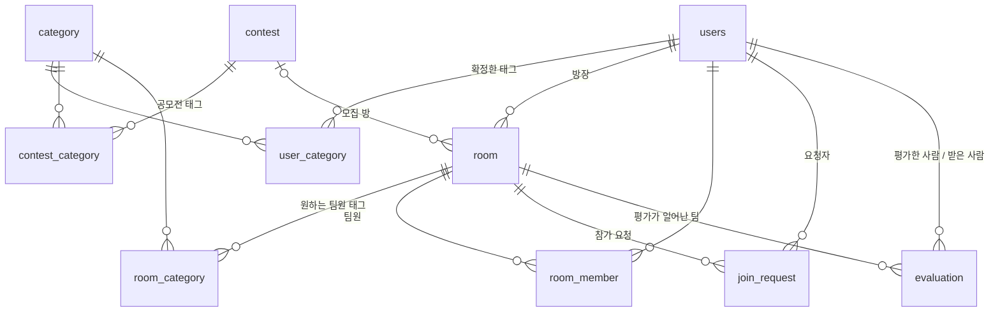

# DB 명세서 (초안)

> 상태: 초안 · 팀 검토 전
> 기준: [기능 명세서 v0.2](feature-spec.md), [시연용 데이터](demo-data.md), [README 기술 스택](../README.md#기술-스택)
> DB: MySQL 8 · InnoDB · `utf8mb4` / `utf8mb4_0900_ai_ci` · JPA `ddl-auto=none`, 테이블은 아래 DDL을 `schema.sql`로 만듭니다.

## 1. 한눈에 보기



| 테이블 | 내용 | 만드는 사람 | 읽는 기능 |
|---|---|---|---|
| `category` | 고정 태그 목록 (X-2) | B | 전체 |
| `users` | 사용자 (A-1) | A | 전체 (X-1 헤더) |
| `user_category` | 사용자가 확정한 태그 (A-3) | A | B-3, C-2 |
| `contest` | 공모아뷰에서 받은 공모전 (B-1) | B | C (방 목록 위 공모전 정보) |
| `contest_category` | 공모전 태그 (B-2) | B | B-3 |
| `room` | 모집 방 = 팀 (C-1) | C | A-5, A-6 |
| `room_category` | 방이 원하는 팀원 태그 | C | C-2 |
| `room_member` | 팀원, 방장 포함 (C-5) | C | A-5, A-6 |
| `join_request` | 참가 요청 (C-4, C-5) | C | - |
| `evaluation` | 팀원 평가 (A-5) | A | A-6 |

"만드는 사람"이 테이블과 JPA 엔티티를 만들고 고칩니다. 다른 사람 테이블은 읽기만 하고, 바꿔야 하면 그 사람에게 요청합니다.

## 2. 공통 규칙

| 항목 | 규칙 |
|---|---|
| 이름 | 테이블·컬럼은 `snake_case`, 테이블은 단수형. `user`는 예약어와 헷갈려서 `users`만 복수형 |
| 기본 키 | `id BIGINT AUTO_INCREMENT`. 태그 연결 테이블 3개는 `(주인 id, category_id)` 복합 키 |
| 상태 값 | MySQL `ENUM` 대신 `VARCHAR(20)` + 영문 대문자. JPA는 `@Enumerated(EnumType.STRING)` |
| 시간 | `DATETIME`, 한국 시간으로 저장 (JDBC URL에 `serverTimezone=Asia/Seoul`) |
| 삭제 | 시연 범위에 삭제 기능은 없습니다. 연결 테이블만 부모가 지워지면 같이 지워지게 `ON DELETE CASCADE` |
| 초기화 (X-5) | 시드 스크립트가 `SET FOREIGN_KEY_CHECKS = 0` → 전 테이블 `TRUNCATE` → 다시 1 → 시드 입력 |

JPA 매핑:
- 태그 연결 테이블(`user_category`, `contest_category`, `room_category`)은 엔티티 없이 `@ManyToMany` + `@JoinTable`로 매핑합니다.
- 컬럼이 더 있는 `room_member`, `join_request`, `evaluation`은 엔티티로 만듭니다.

## 3. 테이블

### 3.1 `category` — 고정 태그 목록 (B, X-2)

| 컬럼 | 타입 | 제약 | 설명 |
|---|---|---|---|
| `id` | BIGINT | PK | |
| `axis` | VARCHAR(20) | NOT NULL | `FIELD` 분야 · `ROLE` 직무 · `SKILL` 기술 · `LEVEL` 수준 · `GOAL` 목표 |
| `code` | VARCHAR(40) | NOT NULL, UNIQUE | 저장·비교용 코드. 분야는 공모아뷰 코드와 같음 |
| `name` | VARCHAR(40) | NOT NULL | 화면에 보이는 이름 |
| `sort_order` | INT | NOT NULL | 축 안에서 보이는 순서 |

전체 값은 [6.1 카테고리 시드](#61-카테고리-시드)에 있습니다. 앱에서 추가·삭제하지 않습니다.

### 3.2 `users` — 사용자 (A, A-1)

| 컬럼 | 타입 | 제약 | 설명 |
|---|---|---|---|
| `id` | BIGINT | PK | 프론트가 `X-User-Id` 헤더로 보내는 값 |
| `name` | VARCHAR(30) | NOT NULL | 화면 이름 (예: `새싹`, `방장 김`) |
| `intro` | TEXT | NULL | 가입 때 쓴 자기소개. 시드 사용자는 비어 있어도 됨 |
| `created_at` | DATETIME | NOT NULL, 기본 현재 시각 | |

로그인이 없어서 비밀번호·이메일 컬럼은 없습니다. 이름이 겹쳐도 됩니다.

### 3.3 `user_category` — 사용자가 확정한 태그 (A, A-3)

| 컬럼 | 타입 | 제약 | 설명 |
|---|---|---|---|
| `user_id` | BIGINT | PK, FK → `users.id` | |
| `category_id` | BIGINT | PK, FK → `category.id` | |

- AI가 제안만 하고 사용자가 확정하지 않은 태그는 저장하지 않습니다. 제안 상태는 프론트가 들고 있습니다.
- 태그를 다시 확정하면 그 사용자의 행을 모두 지우고 새로 넣습니다.

### 3.4 `contest` — 공모전 (B, B-1)

| 컬럼 | 타입 | 제약 | 설명 |
|---|---|---|---|
| `id` | BIGINT | PK | |
| `gongmoa_id` | BIGINT | NOT NULL, UNIQUE | 공모아뷰 공고 번호. upsert 기준 |
| `title` | VARCHAR(255) | NOT NULL | |
| `type` | VARCHAR(20) | NULL | 공모전 / 대외활동 / 교육·강연 (공모아뷰 값 그대로) |
| `host` | VARCHAR(255) | NULL | 주최 |
| `start_date` | DATE | NULL | 접수 시작 |
| `end_date` | DATE | NULL, INDEX | 접수 마감. 추천은 오늘 이후만 |
| `target` | VARCHAR(100) | NULL | 대상 (예: 누구나, `대학생 · 대학원생 · 일반인`). 괄호 조건이 붙기도 함 |
| `prize` | VARCHAR(100) | NULL | `- 1등 상금:` 값 (예: 300만원). 없으면 `- 1등:` 값 (상품명일 수 있음, 예: 노트북). 계산하지 않아서 문자열 |
| `benefit` | VARCHAR(100) | NULL | `- 혜택:` 값 (예: `상금(총상금 : 650만원 / 1위 : 300만원)`, `다양한 혜택`). `prize`가 비었을 때 상세 화면에 대신 보여 줌 |
| `period_mismatch` | BOOLEAN | NOT NULL, 기본 FALSE | `- 주의:` 줄이 있으면 TRUE (상세 화면 경고). 실제 문구는 `출처마다 접수 기간이 다름 — 원문 확인 필요`라서 문구 전체를 비교하지 말고 키로 판정 |
| `gongmoa_url` | VARCHAR(500) | NOT NULL | 출처 표기용 공모아뷰 링크 (필수). 한글 제목이 URL 인코딩돼 300자를 넘기도 함 |
| `source_url` | VARCHAR(500) | NULL | `## 확인할 수 있는 곳`의 `- 주최 측 원문:` 링크. 지원 버튼 링크. 없으면 지원 버튼은 `gongmoa_url`로 보냄 |
| `raw_text` | TEXT | NULL | `get_contest` 원본 마크다운. 파싱 규칙이 바뀌면 다시 파싱 |
| `fetched_at` | DATETIME | NOT NULL | 마지막으로 받은 시각 |

- 마감된 공고는 지우지 않습니다.
- 2026-11-20에 실제 공고 90건(`type=contest`, `target=univ`, 분야 5개)을 받아 컬럼 길이를 확인했습니다. 실제 최대 길이: 제목 49자, 주최 45자, 대상 64자, 1등 상금 6자, 혜택 51자, 공모아뷰 링크 349자, 주최 측 원문 150자. 90건 모두 `접수 기간: YYYY-MM-DD ~ YYYY-MM-DD` 형식이었습니다.
- 90건 중 `1등 상금`이 있는 공고는 49건, `혜택`이 있는 공고는 73건, 주최 측 원문이 없는 공고는 3건이었습니다. `prize`·`benefit`·`source_url`이 비는 경우를 화면에서 처리해야 합니다.
- `활동 기간`, `장소·방식`, `비용`, `후원` 줄이 붙는 공고도 있습니다. 컬럼으로 만들지 않고 `raw_text`에서 읽습니다.
- 상세 화면의 "확인할 수 있는 곳" 목록(링커리어, 씽굿 등)은 `raw_text`에서 읽어 보여 줍니다. 별도 테이블은 만들지 않습니다.

### 3.5 `contest_category` — 공모전 태그 (B, B-2)

| 컬럼 | 타입 | 제약 | 설명 |
|---|---|---|---|
| `contest_id` | BIGINT | PK, FK → `contest.id` | |
| `category_id` | BIGINT | PK, FK → `category.id` | |

분야 태그는 검색한 분야 코드로 붙이고, 나머지 축은 AI가 붙입니다. 같은 공고가 여러 분야 검색에 나오면 분야 태그가 여러 개 붙습니다.

### 3.6 `room` — 모집 방 = 팀 (C, C-1)

| 컬럼 | 타입 | 제약 | 설명 |
|---|---|---|---|
| `id` | BIGINT | PK | |
| `contest_id` | BIGINT | NULL, FK → `contest.id` | 연결된 공모전. **종료된 팀만** 비울 수 있음 |
| `host_id` | BIGINT | NOT NULL, FK → `users.id` | 방장 |
| `title` | VARCHAR(100) | NOT NULL | |
| `intro` | TEXT | NULL | 방 소개 (C-3 AI 초안 재료) |
| `capacity` | TINYINT | NOT NULL, 2~10 | 정원, **방장 포함** |
| `status` | VARCHAR(20) | NOT NULL, 기본 `RECRUITING` | `RECRUITING` 모집 중 · `FULL` 모집 완료 · `CLOSED` 종료 |
| `created_at` | DATETIME | NOT NULL, 기본 현재 시각 | 동점일 때 최신순 정렬 기준 |

- 상태는 `RECRUITING` → `FULL` → `CLOSED` 한 방향으로만 바뀝니다. `CLOSED`는 시드로만 만듭니다.
- "종료된 팀만 공모전을 비울 수 있다"는 앱에서 지킵니다. FK가 걸린 컬럼에는 MySQL `CHECK`를 쓰기 까다로워서입니다.

### 3.7 `room_category` — 방이 원하는 팀원 태그 (C)

| 컬럼 | 타입 | 제약 | 설명 |
|---|---|---|---|
| `room_id` | BIGINT | PK, FK → `room.id` | |
| `category_id` | BIGINT | PK, FK → `category.id` | |

### 3.8 `room_member` — 팀원 (C, C-5)

| 컬럼 | 타입 | 제약 | 설명 |
|---|---|---|---|
| `id` | BIGINT | PK | |
| `room_id` | BIGINT | NOT NULL, FK → `room.id` | |
| `user_id` | BIGINT | NOT NULL, FK → `users.id` | |
| `role` | VARCHAR(20) | NOT NULL | `HOST` 방장 · `MEMBER` 팀원 |
| `joined_at` | DATETIME | NOT NULL, 기본 현재 시각 | |
| | | UNIQUE (`room_id`, `user_id`) | 같은 방에 두 번 들어갈 수 없음 |

- **방장도 이 테이블에 `HOST`로 한 줄 들어갑니다.** 그래서 이 테이블의 행 수가 곧 정원과 비교할 인원입니다.
- 방을 만들 때(C-1, 시드) 방장 행을 같이 넣습니다.

### 3.9 `join_request` — 참가 요청 (C, C-4·C-5)

| 컬럼 | 타입 | 제약 | 설명 |
|---|---|---|---|
| `id` | BIGINT | PK | |
| `room_id` | BIGINT | NOT NULL, FK → `room.id` | |
| `user_id` | BIGINT | NOT NULL, FK → `users.id` | 요청한 사람 |
| `message` | TEXT | NOT NULL | 보낸 메시지 (AI 초안을 고친 최종본) |
| `status` | VARCHAR(20) | NOT NULL, 기본 `PENDING` | `PENDING` 대기 · `ACCEPTED` 수락 · `REJECTED` 거절 |
| `created_at` | DATETIME | NOT NULL, 기본 현재 시각 | |
| `decided_at` | DATETIME | NULL | 수락·거절한 시각 |
| `pending_flag` | TINYINT | 생성 컬럼 | `status = 'PENDING'`이면 1, 아니면 NULL |
| | | UNIQUE (`room_id`, `user_id`, `pending_flag`) | **같은 방에 대기 중 요청은 하나만** (C-4) |

MySQL에는 조건부 UNIQUE가 없어서 생성 컬럼을 씁니다. 대기 중 요청만 1이고 나머지는 NULL이라, 처리된 요청은 몇 개가 있어도 됩니다. JPA 엔티티에서는 이 컬럼을 매핑하지 않습니다.

### 3.10 `evaluation` — 팀원 평가 (A, A-5)

| 컬럼 | 타입 | 제약 | 설명 |
|---|---|---|---|
| `id` | BIGINT | PK | |
| `room_id` | BIGINT | NOT NULL, FK → `room.id` | 평가가 일어난 팀 (종료된 팀) |
| `evaluator_id` | BIGINT | NOT NULL, FK → `users.id` | 평가한 사람 |
| `target_id` | BIGINT | NOT NULL, FK → `users.id` | 평가받은 사람 |
| `score` | TINYINT | NOT NULL, 1~5 | 별점 (평가 항목은 회의에서 확정, 지금은 가정) |
| `comment` | VARCHAR(200) | NULL | 한 줄 코멘트 |
| `created_at` | DATETIME | NOT NULL, 기본 현재 시각 | |
| | | UNIQUE (`room_id`, `evaluator_id`, `target_id`) | 같은 팀에서 한 사람에게 한 번만 |
| | | CHECK (`evaluator_id <> target_id`) | 자기 자신은 평가할 수 없음 |

"종료된 팀이어야 한다", "두 사람 다 그 팀원이어야 한다"는 앱에서 확인합니다 ([5.4](#54-팀원-평가-a-5)).

## 4. DDL (`schema.sql`)

```sql
CREATE TABLE category (
  id          BIGINT       NOT NULL AUTO_INCREMENT,
  axis        VARCHAR(20)  NOT NULL,
  code        VARCHAR(40)  NOT NULL,
  name        VARCHAR(40)  NOT NULL,
  sort_order  INT          NOT NULL,
  PRIMARY KEY (id),
  UNIQUE KEY uk_category_code (code)
);

CREATE TABLE users (
  id          BIGINT       NOT NULL AUTO_INCREMENT,
  name        VARCHAR(30)  NOT NULL,
  intro       TEXT         NULL,
  created_at  DATETIME     NOT NULL DEFAULT CURRENT_TIMESTAMP,
  PRIMARY KEY (id)
);

CREATE TABLE user_category (
  user_id      BIGINT NOT NULL,
  category_id  BIGINT NOT NULL,
  PRIMARY KEY (user_id, category_id),
  CONSTRAINT fk_uc_user     FOREIGN KEY (user_id)     REFERENCES users (id)    ON DELETE CASCADE,
  CONSTRAINT fk_uc_category FOREIGN KEY (category_id) REFERENCES category (id)
);

CREATE TABLE contest (
  id               BIGINT        NOT NULL AUTO_INCREMENT,
  gongmoa_id       BIGINT        NOT NULL,
  title            VARCHAR(255)  NOT NULL,
  type             VARCHAR(20)   NULL,
  host             VARCHAR(255)  NULL,
  start_date       DATE          NULL,
  end_date         DATE          NULL,
  target           VARCHAR(100)  NULL,
  prize            VARCHAR(100)  NULL,
  benefit          VARCHAR(100)  NULL,
  period_mismatch  BOOLEAN       NOT NULL DEFAULT FALSE,
  gongmoa_url      VARCHAR(500)  NOT NULL,
  source_url       VARCHAR(500)  NULL,
  raw_text         TEXT          NULL,
  fetched_at       DATETIME      NOT NULL,
  PRIMARY KEY (id),
  UNIQUE KEY uk_contest_gongmoa (gongmoa_id),
  KEY idx_contest_end_date (end_date)
);

CREATE TABLE contest_category (
  contest_id   BIGINT NOT NULL,
  category_id  BIGINT NOT NULL,
  PRIMARY KEY (contest_id, category_id),
  CONSTRAINT fk_cc_contest  FOREIGN KEY (contest_id)  REFERENCES contest (id)  ON DELETE CASCADE,
  CONSTRAINT fk_cc_category FOREIGN KEY (category_id) REFERENCES category (id)
);

CREATE TABLE room (
  id          BIGINT        NOT NULL AUTO_INCREMENT,
  contest_id  BIGINT        NULL,
  host_id     BIGINT        NOT NULL,
  title       VARCHAR(100)  NOT NULL,
  intro       TEXT          NULL,
  capacity    TINYINT       NOT NULL,
  status      VARCHAR(20)   NOT NULL DEFAULT 'RECRUITING',
  created_at  DATETIME      NOT NULL DEFAULT CURRENT_TIMESTAMP,
  PRIMARY KEY (id),
  KEY idx_room_contest (contest_id, status),
  CONSTRAINT fk_room_contest FOREIGN KEY (contest_id) REFERENCES contest (id),
  CONSTRAINT fk_room_host    FOREIGN KEY (host_id)    REFERENCES users (id),
  CONSTRAINT ck_room_capacity CHECK (capacity BETWEEN 2 AND 10),
  CONSTRAINT ck_room_status   CHECK (status IN ('RECRUITING', 'FULL', 'CLOSED'))
);

CREATE TABLE room_category (
  room_id      BIGINT NOT NULL,
  category_id  BIGINT NOT NULL,
  PRIMARY KEY (room_id, category_id),
  CONSTRAINT fk_rc_room     FOREIGN KEY (room_id)     REFERENCES room (id)     ON DELETE CASCADE,
  CONSTRAINT fk_rc_category FOREIGN KEY (category_id) REFERENCES category (id)
);

CREATE TABLE room_member (
  id         BIGINT       NOT NULL AUTO_INCREMENT,
  room_id    BIGINT       NOT NULL,
  user_id    BIGINT       NOT NULL,
  role       VARCHAR(20)  NOT NULL,
  joined_at  DATETIME     NOT NULL DEFAULT CURRENT_TIMESTAMP,
  PRIMARY KEY (id),
  UNIQUE KEY uk_member_room_user (room_id, user_id),
  KEY idx_member_user (user_id),
  CONSTRAINT fk_member_room FOREIGN KEY (room_id) REFERENCES room (id) ON DELETE CASCADE,
  CONSTRAINT fk_member_user FOREIGN KEY (user_id) REFERENCES users (id),
  CONSTRAINT ck_member_role CHECK (role IN ('HOST', 'MEMBER'))
);

CREATE TABLE join_request (
  id            BIGINT       NOT NULL AUTO_INCREMENT,
  room_id       BIGINT       NOT NULL,
  user_id       BIGINT       NOT NULL,
  message       TEXT         NOT NULL,
  status        VARCHAR(20)  NOT NULL DEFAULT 'PENDING',
  created_at    DATETIME     NOT NULL DEFAULT CURRENT_TIMESTAMP,
  decided_at    DATETIME     NULL,
  pending_flag  TINYINT GENERATED ALWAYS AS (CASE WHEN status = 'PENDING' THEN 1 END) STORED,
  PRIMARY KEY (id),
  UNIQUE KEY uk_request_one_pending (room_id, user_id, pending_flag),
  KEY idx_request_room_status (room_id, status),
  CONSTRAINT fk_request_room FOREIGN KEY (room_id) REFERENCES room (id) ON DELETE CASCADE,
  CONSTRAINT fk_request_user FOREIGN KEY (user_id) REFERENCES users (id),
  CONSTRAINT ck_request_status CHECK (status IN ('PENDING', 'ACCEPTED', 'REJECTED'))
);

CREATE TABLE evaluation (
  id            BIGINT        NOT NULL AUTO_INCREMENT,
  room_id       BIGINT        NOT NULL,
  evaluator_id  BIGINT        NOT NULL,
  target_id     BIGINT        NOT NULL,
  score         TINYINT       NOT NULL,
  comment       VARCHAR(200)  NULL,
  created_at    DATETIME      NOT NULL DEFAULT CURRENT_TIMESTAMP,
  PRIMARY KEY (id),
  UNIQUE KEY uk_eval_once (room_id, evaluator_id, target_id),
  KEY idx_eval_target (target_id),
  CONSTRAINT fk_eval_room      FOREIGN KEY (room_id)      REFERENCES room (id) ON DELETE CASCADE,
  CONSTRAINT fk_eval_evaluator FOREIGN KEY (evaluator_id) REFERENCES users (id),
  CONSTRAINT fk_eval_target    FOREIGN KEY (target_id)    REFERENCES users (id),
  CONSTRAINT ck_eval_score CHECK (score BETWEEN 1 AND 5),
  CONSTRAINT ck_eval_not_self CHECK (evaluator_id <> target_id)
);
```

## 5. 주요 쿼리와 처리 순서

### 5.1 공모전 추천 (B-3)

겹침 0개인 공모전도 나오도록 `LEFT JOIN`으로 셉니다. 동점이면 마감 임박순입니다.

```sql
SELECT c.*, COUNT(uc.category_id) AS overlap
FROM contest c
LEFT JOIN contest_category cc ON cc.contest_id = c.id
LEFT JOIN user_category uc   ON uc.category_id = cc.category_id AND uc.user_id = :userId
WHERE c.end_date >= CURDATE()
GROUP BY c.id
ORDER BY overlap DESC, c.end_date ASC;
```

### 5.2 모집 방 목록 (C-2)

모집 중인 방이 먼저, 그 안에서 겹침 많은 순, 동점이면 최신순입니다. 종료된 팀은 빠집니다.

```sql
SELECT r.*,
       COUNT(uc.category_id) AS overlap,
       (SELECT COUNT(*) FROM room_member m WHERE m.room_id = r.id) AS member_count
FROM room r
LEFT JOIN room_category rc ON rc.room_id = r.id
LEFT JOIN user_category uc ON uc.category_id = rc.category_id AND uc.user_id = :userId
WHERE r.contest_id = :contestId
  AND r.status IN ('RECRUITING', 'FULL')
GROUP BY r.id
ORDER BY (r.status = 'FULL') ASC, overlap DESC, r.created_at DESC;
```

### 5.3 참가 요청 수락 (C-5)

한 트랜잭션(`@Transactional`) 안에서 이 순서로 처리합니다. 방 행을 먼저 잠가서, 두 요청을 동시에 수락해도 정원을 넘지 않게 합니다.

1. `SELECT * FROM room WHERE id = :roomId FOR UPDATE` (JPA `@Lock(PESSIMISTIC_WRITE)`)
2. 요청이 `PENDING`이고, 방이 `RECRUITING`이고, 현재 사용자가 방장인지 확인합니다. 아니면 거절합니다.
3. `room_member`에 요청자를 `MEMBER`로 넣습니다.
4. 요청을 `ACCEPTED`로 바꾸고 `decided_at`을 기록합니다.
5. `room_member` 행 수가 `capacity`와 같으면:
   - 방을 `FULL`로 바꿉니다.
   - 같은 방의 남은 `PENDING` 요청을 모두 `REJECTED`로 바꿉니다.

### 5.4 팀원 평가 (A-5)

저장하기 전에 앱에서 확인합니다.

1. 방이 `CLOSED`인지
2. 평가하는 사람과 받는 사람이 둘 다 그 방의 `room_member`인지
3. 이미 평가했는지 (UNIQUE에 걸리면 "이미 평가했어요")

### 5.5 프로필 평가 요약 (A-6)

```sql
SELECT ROUND(AVG(score), 1) AS avg_score, COUNT(*) AS eval_count
FROM evaluation
WHERE target_id = :userId;
```

## 6. 시드 데이터 (X-5)

[시연용 데이터](demo-data.md)를 테이블로 옮긴 것입니다.

### 6.1 카테고리 시드

| axis | code → name |
|---|---|
| `FIELD` | `it` IT · `idea` 기획·아이디어 · `design` 디자인 · `art` 미술·음악 · `video` 영상·사진 · `writing` 문학·논문 · `naming` 네이밍·슬로건 · `marketing` 마케팅 · `startup` 취업·창업 · `supporters` 서포터즈·기자단 · `volunteer` 봉사·체험 · `etc` 기타 |
| `ROLE` | `backend` 백엔드 · `frontend` 프론트엔드 · `app` 앱 · `ai_data` AI·데이터 · `uiux` UI/UX · `planning` 기획 |
| `SKILL` | `java` Java · `spring` Spring · `python` Python · `javascript` JavaScript · `react` React · `kotlin` Kotlin · `figma` Figma |
| `LEVEL` | `beginner` 초보 · `experienced` 경험 있음 · `expert` 숙련 |
| `GOAL` | `learn` 배우고 싶음 · `portfolio` 포트폴리오 · `award` 수상 목표 |

`sort_order`는 위 순서대로 1부터 매깁니다.

### 6.2 사용자

| id | name | 태그 (code) |
|---|---|---|
| 1 | 방장 김 | `it` `backend` `java` `experienced` `portfolio` |
| 2 | 방장 이 | `it` `backend` `spring` `expert` `award` |
| 3 | 방장 박 | `it` `app` `kotlin` `beginner` |
| 4 | 방장 최 | `design` `uiux` `figma` `expert` |
| 5 | 팀원 정 | `it` `frontend` `react` `beginner` `learn` |
| 6 | 팀원 한 | `it` `frontend` `javascript` `experienced` |
| 7 | 새싹(작년) | `it` `backend` `java` `beginner` `learn` |

페르소나 "새싹"은 시드에 없고 시연 중에 가입합니다 (id 8부터).

### 6.3 방과 팀원

방 1~4의 `contest_id`는 주인공 공모전입니다. 시드 스크립트가 고정한 `gongmoa_id`로 `contest.id`를 찾아 넣습니다.

| id | 방 | host | capacity | status | 원하는 팀원 태그 | room_member |
|---|---|---|---|---|---|---|
| 1 | 초보 환영! 백엔드 같이 배워요 | 1 김 | 3 | `RECRUITING` | `it` `backend` `java` `beginner` `learn` | 1 (HOST), 5 (MEMBER) |
| 2 | Spring 서버 개발자 구합니다 | 2 이 | 4 | `RECRUITING` | `it` `backend` `java` `spring` `award` | 2 (HOST) |
| 3 | 앱 서비스 같이 만들 분 | 3 박 | 3 | `RECRUITING` | `it` `app` `kotlin` `beginner` | 3 (HOST) |
| 4 | 디자인 강한 팀, 개발자 1명 | 4 최 | 4 | `RECRUITING` | `it` `uiux` `figma` `expert` | 4 (HOST) |
| 5 | 작년 캠퍼스 해커톤 팀 | 1 김 | 3 | `CLOSED` | (없음) | 7 (MEMBER), 6 (MEMBER), 1 (HOST) |

방 1~4의 `created_at`은 1이 가장 최근이 되게 넣습니다. 그래야 겹침이 같을 때도 순서가 흔들리지 않습니다.

### 6.4 평가

| room | evaluator | target | score | comment |
|---|---|---|---|---|
| 5 | 1 김 | 6 한 | 5 | API 연결 부분까지 같이 봐 줘서 든든했어요. |

시연 중에 새싹(작년)이 한을 평가하면 평균 별점이 5.0 → 4.5가 됩니다.

## 7. 맞춰야 할 것

- [ ] **방4 인원이 디자인과 달라요.** 디자인 화면은 방4를 "3 / 4명"(디자이너 3명)으로 그렸는데, 시연 데이터에는 방장 최만 있어서 시드로는 "1 / 4명"이 됩니다. 시드에 디자이너 2명을 더하거나, 디자인을 1 / 4명으로 고칩니다.
- [ ] 평가 항목이 회의에서 바뀌면 `evaluation`의 `score`, `comment` 컬럼을 고칩니다.
- [ ] 방과 공모전을 1:1로 확정하지 않으면 `room.contest_id` 대신 연결 테이블이 필요합니다.
- [ ] 수준 태그를 사용자당 1개로 제한할지 정합니다. 제한하면 A-3에서 막습니다 (DB 제약은 걸지 않음).
